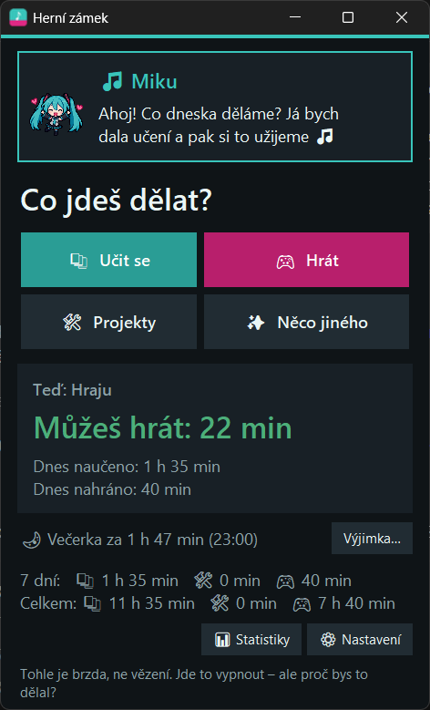
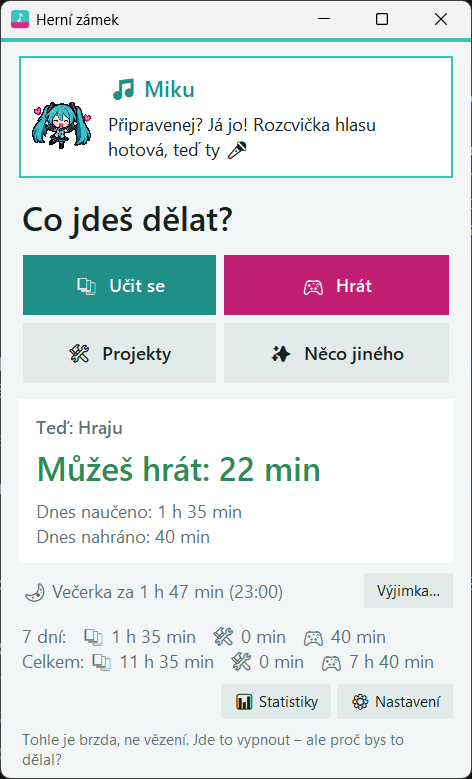
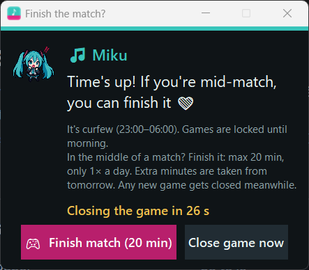
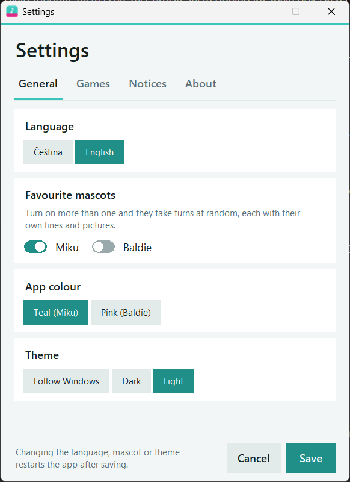

# Herní zámek (Game Lock Companion) 🎵

**Nejdřív učení, pak hry.** Malá appka pro Windows, macOS a Linux, která tě nepustí hrát, dokud se neučíš.
Každá minuta učení ti vydělá čas na hraní. Miku ti dělá společnost, fandí ti a zavře hru,
když čas dojde.

> **[🇬🇧 English](README.md)** · Nápad a návrh: **[N0V1RU5](https://github.com/N0V1RU5)** · Open source (MIT)

<p>
  
  
</p>

Udělal jsem ji, protože hraju víc, než chci. Je to **brzda, ne vězení**: přes Správce úloh ji
vypneš vždycky. Ale přidá přesně tolik tření, abys šel nejdřív dělat to důležité.

## Co umí

- **Čas na hraní za učení.** Výchozí: prvních 30 min učení za den 1:1, potom 2 min učení = 1 min hraní.
- **Zavře hru**, když ti došel čas, když jsi v režimu Učení a ve **večerku** (23:00–6:00).
- **„Jsi tu?“** každých 20 min při učení, aby časovač neběžel, když jsi pryč.
- **Dohrání zápasu.** Když čas dojde uprostřed hry, máš 90 s na kliknutí *Dohrát zápas* (max 20 min, 1× denně). Minuty navíc se odečtou zítra.
- **Výjimka** s napsaným důvodem a 10min čekáním (1× denně).
- **Hry ze Steamu najde sama.** Jakoukoliv jinou hru přidáš výběrem `.exe` nebo složky.
- **Čeština / angličtina**, **tmavý / světlý** vzhled (nebo podle systému).
- Ikona u hodin se zbývajícími minutami, varování 10 a 2 min před koncem, statistiky po dnech v Excelu (`stats.xlsx`).
- **Nenáročná:** ~22 MB RAM, 10 MB ke stažení, hry kontroluje každé 2 s skoro bez zátěže procesoru. Na disk zapisuje, jen když se něco změní.

<p>
  
  
</p>

## Instalace

### Windows 10/11

1. Stáhni **`GameLockCompanion-windows.zip`** z [Releases](https://github.com/N0V1RU5/game-lock-companion/releases/latest).
2. Rozbal celou složku někam natrvalo, třeba do `Dokumenty\GameLockCompanion` (ne do Stažených). Složka `_internal` musí zůstat vedle exe.
3. Spusť **`GameLockCompanion.exe`**. Windows SmartScreen může varovat, protože appka není podepsaná: *Další informace → Přesto spustit*. Některé antiviry nemají rády appky, co zavírají jiné procesy; je to falešný poplach.
4. Vyber jazyk. Appka se sama přidá do spouštění s Windows (vypneš v menu ikony u hodin).
5. Otevři **⚙ Nastavení** a přidej hry mimo Steam (**+ Hra (.exe)** nebo **+ Složka s hrami**).

### macOS a Linux

Stáhni `GameLockCompanion-macos.zip` nebo `GameLockCompanion-linux.zip` z
[Releases](https://github.com/N0V1RU5/game-lock-companion/releases/latest), rozbal a spusť `GameLockCompanion`,
nebo appku spusť ze zdrojáků (níž). V **⚙ Nastavení** zapni **Spouštět po přihlášení do systému**.

- **macOS:** ikona v horní liště není, appka je v Docku a zavřením okna se minimalizuje.
  Napoprvé ji může zablokovat Gatekeeper: pravý klik na appku → *Otevřít*.
- **Linux:** ikona u hodin potřebuje systémovou lištu (KDE, Xfce, Cinnamon; v GNOME rozšíření *AppIndicator*).
  Bez ní se appka minimalizuje na hlavní panel.

### Spuštění ze zdrojáků (všechny systémy)

Python 3.10+ s Tk.

```bash
python -m pip install psutil            # Windows a macOS
python -m pip install psutil pystray pillow   # Linux (ikona u hodin)
python herni_zamek.pyw
```

Na Linuxu může být potřeba doinstalovat Tk: `sudo apt install python3-tk`. Na Windows spouštěj přes `pythonw`
(bez okna konzole) a pro spouštění s Windows dej zástupce na `herni_zamek.pyw` do `shell:startup`.

## Jak to funguje

| Režim | Co se děje |
|---|---|
| 📚 Učit se | Běží časovač učení, hry se zavírají. Každých 20 min „Jsi tu?“ |
| 🎮 Hrát | Hry můžou běžet, dokud máš čas. Odečítá se jen, když hra opravdu běží. |
| 📺 Seriál / ✨ Něco jiného | Nic se nepočítá. |

- Čas na hraní platí jen ten den, o půlnoci se vynuluje (žádné šetření na víkend).
- Appka kontroluje hry každé 2 s. Po vypnutí hry se sama přepne z *Hraju* na *Něco jiného*.
- Hry s anti-cheatem (Rainbow Six / BattlEye, EAC) na Windows nejdou zabít natvrdo, appka je zavře jako Alt+F4.

### Co se bere jako hra

- Všechno ve Steam knihovnách (`steamapps/common`), když je zapnuté *Automaticky hlídat všechny hry ze Steamu*.
  Steam se najde sám na Windows, macOS i Linuxu (i Flatpak a Snap), na Linuxu i Windows hry přes Proton.
- Každá hra a složka, které přidáš v **Nastavení** (`.exe` na Windows, aplikace nebo program na macOS a Linuxu).
- Minecraft Java: přidej `"minecraft"` do `java_keywords` v `config.json`.
- **Nikdy se nezavře:** programy v *Není hra*, cokoliv se slovem `server` v názvu, nástroje ze Steamu jako Wallpaper Engine.

## Nastavení

Jazyk, vzhled a hry jsou v **⚙ Nastavení**. Pravidla jsou v `config.json`
(vytvoří se vedle appky při prvním spuštění, výchozí hodnoty jsou v `config.default.json`):

| Klíč | Výchozí | Význam |
|---|---|---|
| `play_per_study` | `0.5` | min hraní za 1 min učení (po rozjezdu) |
| `kickstart_min` / `kickstart_multiplier` | `30` / `1.0` | prvních N min učení za den má tenhle poměr |
| `curfew_start` / `curfew_end` | `"23:00"` / `"06:00"` | večerka, hry se zavřou vždycky |
| `curfew_warning_min` | `15` | varování před večerkou |
| `presence_check_every_min` / `presence_answer_within_min` | `20` / `2` | „Jsi tu?“ |
| `override_wait_min` / `override_bonus_min` / `override_max_per_day` | `10` / `30` / `1` | výjimka |
| `finish_match_min` / `finish_match_per_day` / `finish_prompt_sec` | `20` / `1` / `90` | dohrání zápasu |
| `warn_before_end_min` | `[10, 2]` | varování před koncem hraní |
| `game_exe`, `game_roots`, `java_keywords`, `steam_auto` | | co je hra |
| `whitelist_exe`, `whitelist_name_contains`, `whitelist_dirs` | | co se nikdy nezavře |

Po úpravě `config.json` appku restartuj (Správce úloh → ukončit → spustit znovu).

## Vlastní postava

Hlášky Miku jsou v `personas.json` (`cs` a `en`, `{min}` = počet minut). Obrázky jsou v `obrazky/`:
`happy`, `study`, `angry`, `sleepy`, `alert` jako `.gif` (může být animovaný) nebo `.png`, kolem 100×100 px.
`tools/import_obrazky.py` převede soubor z Aseprite, sprite sheet nebo složku obrázků do tohohle formátu.

## Vývoj

```bash
python tools/test_zamek.py          # testy pravidel
python herni_zamek.pyw --selftest   # jednou otevře okna a skončí (0 = v pořádku)
python tools/screenshots.py         # screenshoty do README (Windows)
python tools/build_exe.py           # appka + zip do dist/ pro aktuální systém (potřebuje pyinstaller)
```

`zamek_core.py` jsou pravidla (bez GUI), `herni_zamek.pyw` okno a ikona u hodin, `win_tray.py` ikona u hodin
na Windows (čisté Win32 API, bez dalších knihoven), `i18n.py` texty. GitHub Actions spouští testy na Windows,
macOS i Linuxu a tag `v*` sestaví do releasu všechny tři zipy.

## Licence

Kód: [MIT](LICENSE) © N0V1RU5. Obrázky Miku: nekomerční fan art, viz [NOTICE](NOTICE.md).

Když máš pocit, že ti hraní přerůstá přes hlavu, řekni to někomu, komu věříš, nebo zavolej
na Linku první psychické pomoci **116 123** (zdarma, nonstop). Appka je pomocník, ne léčba.

---

<sub>Při programování pomáhal Claude (Anthropic) jako asistent.</sub>
