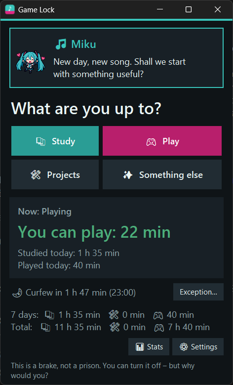
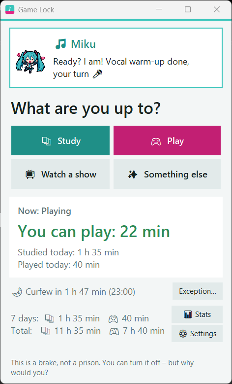
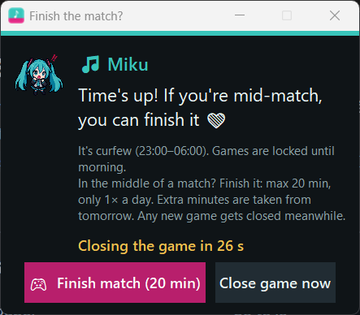
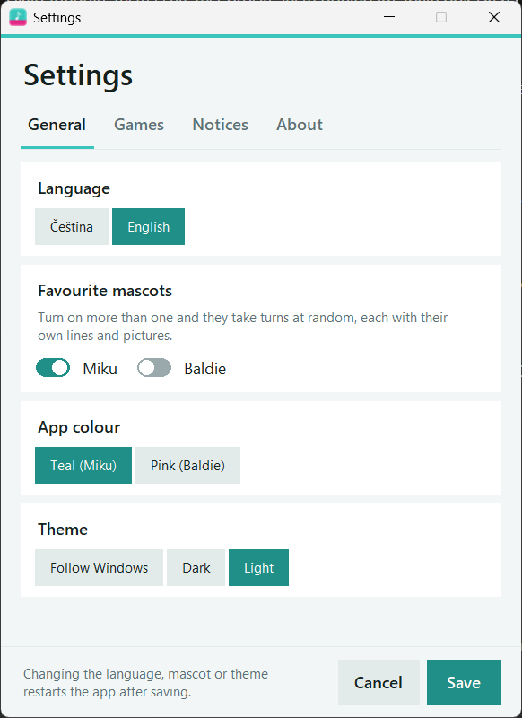
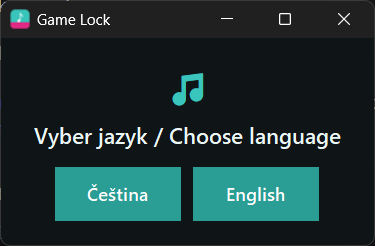

# Game Lock Companion 🎵

**Study first, then games.** A small app for Windows, macOS and Linux that won't let you play until you've studied.
Every minute you study earns you play time. Miku keeps you company, cheers you on and closes
games when time is up.

> **[🇨🇿 Česky](README.cs.md)** · Idea & design: **[N0V1RU5](https://github.com/N0V1RU5)** · Open source (MIT)

<p>
  
  
</p>

I made this because I play more than I want to. It's a **brake, not a prison** – you can
always kill it in Task Manager. But it adds just enough friction to make you study first.

## Features

- **Earn play time by studying.** By default the first 30 min of study each day = 1:1, then 2 min of study = 1 min of play.
- **Games are closed** when you have no time left, while you're in Study mode, and during **curfew** (23:00–6:00).
- **"Are you there?"** check every 20 min while studying, so the timer can't run while you're AFK.
- **Finish the match.** When time runs out mid-game, you get 90 s to click *Finish match* (max 20 min, once a day). Borrowed minutes are taken from tomorrow.
- **Exception** with a written reason and a 10-minute wait (once a day).
- **Steam games are detected automatically.** Add any other game by picking its `.exe` or a folder.
- **Czech / English**, **dark / light** theme (or follow the system).
- Tray icon with minutes left, warnings 10 and 2 min before the end, daily stats in Excel (`stats.xlsx`).
- **Lightweight:** ~22 MB of RAM, a 9 MB download on Windows (12 MB macOS, 29 MB Linux), checks for games every 2 s with almost no CPU. Data is only written to disk when something changes.

<p>
  
  
</p>

## Install

### Windows 10/11

1. Download **`GameLockCompanion-windows.zip`** from [Releases](https://github.com/N0V1RU5/game-lock-companion/releases/latest).
2. Unzip the whole folder somewhere permanent, e.g. `Documents\GameLockCompanion` (not Downloads). Keep the `_internal` folder next to the exe.
3. Run **`GameLockCompanion.exe`**. Windows SmartScreen may warn you because the app isn't signed: click *More info → Run anyway*. Some antiviruses dislike apps that close other processes; that's a false positive.
4. Pick your language. The app adds itself to Windows startup (toggle it in the tray icon menu).
5. Open **⚙ Settings** and add your non-Steam games (**+ Game (.exe)** or **+ Games folder**).



### macOS and Linux

Download `GameLockCompanion-macos.zip` or `GameLockCompanion-linux.zip` from
[Releases](https://github.com/N0V1RU5/game-lock-companion/releases/latest), unzip it and run `GameLockCompanion`,
or run it from source (below). Turn on **Start when I log in** in **⚙ Settings**.

- **macOS:** there is no menu-bar icon; the app lives in the Dock and closing the window minimises it.
  The first start may be blocked by Gatekeeper: right-click the app → *Open*.
- **Linux:** the tray icon needs a system tray (KDE, Xfce, Cinnamon; on GNOME the *AppIndicator* extension).
  Without one the app minimises to the taskbar.

### Run from source (all systems)

Python 3.10+ with Tk.

```bash
python -m pip install psutil            # Windows and macOS
python -m pip install psutil pystray pillow   # Linux (tray icon)
python herni_zamek.pyw
```

Linux may need Tk first: `sudo apt install python3-tk`. On Windows use `pythonw` to run without a console
window, and put a shortcut to `herni_zamek.pyw` into `shell:startup` to start it with Windows.

## How it works

| Mode | What happens |
|---|---|
| 📚 Study | Study timer runs, games are closed. Every 20 min: "Are you there?" |
| 🎮 Play | Games may run while you have time left. Time only counts while a game is running. |
| 📺 Show / ✨ Something else | Nothing is counted. |

- Play time is per day and resets at midnight (no saving up for the weekend).
- The app checks running games every 2 s. After you close a game it switches from *Playing* back to *Something else*.
- Games with anti-cheat (Rainbow Six / BattlEye, EAC) can't be force-killed on Windows, so the app closes them like Alt+F4.

### What counts as a game

- Everything inside Steam libraries (`steamapps/common`) when *Automatically watch all Steam games* is on.
  Steam is found automatically on Windows, macOS and Linux (including Flatpak and Snap), and on Linux also
  Windows games running through Proton.
- Every game and folder you add in **Settings** (`.exe` on Windows, an app or program on macOS and Linux).
- Minecraft Java: add `"minecraft"` to `java_keywords` in `config.json`.
- **Never closed:** programs in *Not a game*, anything with `server` in its name, Steam tools like Wallpaper Engine.

## Settings

Language, theme and games are in **⚙ Settings**. The rules are in `config.json`
(created next to the app on first start, defaults in `config.default.json`):

| Key | Default | Meaning |
|---|---|---|
| `play_per_study` | `0.5` | minutes of play for 1 min of study (after the kickstart) |
| `kickstart_min` / `kickstart_multiplier` | `30` / `1.0` | first N min of study per day use this ratio |
| `curfew_start` / `curfew_end` | `"23:00"` / `"06:00"` | curfew; games are always closed |
| `curfew_warning_min` | `15` | warning before curfew |
| `presence_check_every_min` / `presence_answer_within_min` | `20` / `2` | "Are you there?" |
| `override_wait_min` / `override_bonus_min` / `override_max_per_day` | `10` / `30` / `1` | exception |
| `finish_match_min` / `finish_match_per_day` / `finish_prompt_sec` | `20` / `1` / `90` | finish the match |
| `warn_before_end_min` | `[10, 2]` | warnings before play time ends |
| `game_exe`, `game_roots`, `java_keywords`, `steam_auto` | | what is a game |
| `whitelist_exe`, `whitelist_name_contains`, `whitelist_dirs` | | what is never closed |

Restart the app after editing `config.json` (tray icon → quit in Task Manager → run again).

## Your own character

Miku's lines are in `personas.json` (`cs` and `en`, `{min}` = minutes). Images are in `obrazky/`:
`happy`, `study`, `angry`, `sleepy`, `alert` as `.gif` (can be animated) or `.png`, around 100×100 px.
`tools/import_obrazky.py` converts an Aseprite file, a sprite sheet or a folder of images into that format.

## Development

```bash
python tools/test_zamek.py          # rules tests
python herni_zamek.pyw --selftest   # opens the windows once and exits (0 = OK)
python tools/screenshots.py         # README screenshots (Windows)
python tools/build_exe.py           # app + zip into dist/ for the current system (needs pyinstaller)
```

`zamek_core.py` has the rules (no GUI), `herni_zamek.pyw` the window and tray icon, `win_tray.py` the
Windows tray icon (plain Win32 API, no extra libraries), `i18n.py` the texts. GitHub Actions run the tests on
Windows, macOS and Linux, and a `v*` tag builds the three zips into the release.

## License

Code: [MIT](LICENSE) © N0V1RU5. Miku art: non-commercial fan work, see [NOTICE](NOTICE.md).

If you feel gaming is taking over your life, talk to someone you trust or a counselling service. This app is a helper, not a cure.

---

<sub>Built with help from Claude (Anthropic) as a coding assistant.</sub>
